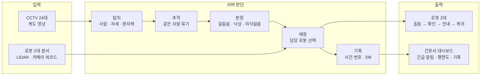

# 다시, 봄 (DWGR)

> **CCTV가 찾고, 로봇이 데려다주고, 위험하면 바로 알린다.**
> 고령 입원환자의 길잃음을 안내하고, 낙상과 의식잃음을 감지하는 병동 안내 로봇 (ROS 2 시뮬레이션)



| 항목 | 내용 |
| --- | --- |
| 과정 | 스마트인재개발원 피지컬 AI 과정 · 로봇 제어 핵심 프로젝트 · 5팀 '대답해어서' (4명) |
| 기간 | 2026.10 ~ 2026.11.09 (최종 발표) |
| 환경 | 3층 가상 병동 (층당 72 × 56 m, 병실 68실) · CCTV 24대 · 로봇 2대 · 사람 모델 27명 · 엘리베이터 2대 |

---

## 1. 왜 만들었나

- 65세 이상 환자의 진료 비중은 43.1%에서 46.0%로 늘었고, 낙상은 환자안전사고 중 높은 비율을 차지합니다.
- 간호사 1명이 환자 10~30명을 맡습니다. 한 명을 병실로 데려다주는 동안 나머지 환자는 비게 됩니다.
- 기존 배회 감지기는 **알림에서 끝납니다.** 결국 사람이 가서 데려다줘야 합니다.

그래서 **발견은 CCTV, 안내는 로봇, 위험 판단은 간호사**에게 나눴습니다. 로봇은 환자에게 묻고, 안내하고, 기다릴 뿐 신체 접촉이나 물리적 제지는 하지 않습니다.

## 2. 검증 결과

| 항목 | 기준 | 결과 |
| --- | --- | --- |
| 판정 → 대시보드 알림 지연 | 1초 이내 | **0.01~0.02초** (11/6 최종 통합 점검) |
| 로봇 충돌 | 0회 | demo_all 시나리오 전체 0회 |
| 시뮬레이션 실시간 비율 (CCTV 24대 가동) | 0.7 이상 | 0.74~0.85 |
| 자동 시험 | 전체 통과 | A 11/11 · B1 10/10 · B2 10/10 · B3 10/10 · C 9/9 (11/3) |
| 판정 → 로봇 배정 | 1초 이내 | 0초 |
| 배터리 | 20% 아래로 떨어지지 않음 | 완주 뒤 robot1 79% · robot2 61% |
| 로봇 출동 시간 (LiDAR 수정 전 → 후) | — | 463초 → 36초 |

> 시연 영상과 위 통합 점검은 **정답값 탐지기(`detector:=sim`)** 로 판정·출동·안내 흐름을 맞춘 결과입니다. YOLO 탐지기(`detector:=yolo`)는 서 있는 사람과 휠체어 환자 탐지까지 확인했고, 누운 사람(낙상) 탐지와 바코드 1 m 판독은 추가 검증이 남아 있습니다.

## 3. 주요 기능

### CCTV 탐지와 판정 (규칙 기반)

| 상황 | 대상 | 판정 규칙 | 대응 |
| --- | --- | --- | --- |
| 길잃음 | 분홍 환자복 = 65세 이상 등록 환자 | R1 복도에 누적 60초 머무름 / R2 20초 안에 방향을 120° 넘게 2번 바꿈 | 담당 로봇 출동 → 병실 안내 |
| 낙상 | 복도의 모든 사람 | 서 있다가 1.5초 안에 눕고 2초 유지 | 대시보드 긴급 알림 |
| 휠체어 의식잃음 | 복도의 모든 사람 | 앉은 자세로 60초 동안 0.3 m 미만 이동 | 대시보드 긴급 알림 |

화장실·간호 스테이션 문 앞 3 m, 휴게 공간, 앉은 자세에서는 시간을 세지 않아 과도한 출동을 막았습니다.

### 로봇 임무 흐름

```
STANDBY  대기·충전 (robot1 북쪽 절반 / robot2 남쪽 절반 담당)
  → APPROACH  환자 앞 1.3 m로 출동, 다른 층이면 엘리베이터 이용
  → ASSESS    바코드 명찰로 환자 확인 → "병실로 안내해 드릴까요?" (음성 + 화면)
  → GUIDING   Nav2 0.4 m/s로 병실까지 안내, 1.5 m 뒤처지면 멈추고 기다림
  → RETURN    입실 확인 뒤 대기 자리로 복귀·충전
  ⤷ ALERT     복귀 거부 · 환자 확인 실패 · 안내 중 쓰러짐 → 정지 후 간호사 확인 대기
```

### 간호사 대시보드

- 알림 6종을 우선순위대로 표시 (낙상 · 의식잃음 · 복귀 거부 · 확인 실패 순)
- 사건 번호(W/F/U-MMDD-nnn) · 위치 · 조치자 · 메모를 SQLite에 저장하고, 간호사가 확인해야 알림 종료
- 층별 평면도에 로봇 위치와 상태, 배터리 표시

## 4. 기술 스택

| 분야 | 기술 |
| --- | --- |
| 환경·시뮬레이션 | Ubuntu 22.04 · ROS 2 Humble · Gazebo Classic 11 · Python 3.10 |
| 로봇·주행 | TurtleBot3 Waffle Pi ×2 (+ 안내용 외장) · 층별 지도 · AMCL · Nav2 · LiDAR(gpu_ray) · IMU |
| 탐지·확인 | YOLOv8n · OpenCV(HSV 옷 색·자세) · pyzbar(Code128 바코드) |
| 화면·음성·기록 | Flask 대시보드 · 로봇 전면/후면 화면(PIL) · edge-tts 음성 · SQLite 이벤트 DB |
| 사람 모델 | Meshy · Mixamo로 만든 actor 27명 |

## 5. 패키지 구성

| 패키지 | 내용 |
| --- | --- |
| `pkg_dwgr_sim` | 가상 병동 월드·로봇 모델·엘리베이터·안전 정지(safety_guard)·로봇 감시, 통합 실행 `dwgr_all.launch.py` |
| `pkg_dwgr_safety` | CCTV 탐지·추적·판정, 출동 배정(dispatcher), 사람 모델 |
| `pkg_dwgr_care` | 로봇 화면(robot_ui)·안내(guide_node)·대시보드·음성 |

## 6. 실행 방법

```bash
# 월드·로봇 모델 생성 후 빌드 (지도가 바뀔 때만 make_map.py 별도 실행)
python3 make_textures.py && python3 make_world.py && python3 make_robot_sdf.py && python3 make_nav2_params.py
colcon build --symlink-install
source install/setup.bash

# 통합 실행: 월드(0초) → robot1(6초) → robot2(14초) → 노드(30초) → 시나리오(40초)
ros2 launch pkg_dwgr_sim dwgr_all.launch.py scenario:=demo_all detector:=sim   # 또는 detector:=yolo
```

## 7. 트러블슈팅

| 문제 | 원인 | 해결 | 결과 |
| --- | --- | --- | --- |
| 로봇 LiDAR가 사람을 보지 못하고 지나침 | 사람 모델(actor)이 물리 계산 밖에 있어 기본 LiDAR에 잡히지 않음 | gpu_ray LiDAR로 교체, 정지 조건 재조정 | 사람과의 최소 거리 0.01 m → 0.94 m, 출동 시간 463초 → 36초 |
| 로봇 카메라가 환자 명찰 바코드를 읽지 못함 (7개 거리에서 21번 중 1번 판독) | 명찰이 옷 굴곡을 따라 휘고, 막대 폭 56%라 가장 가는 선이 약 1 px로 뭉개짐 | 명찰을 평판으로 바꾸고 막대 폭 78%로 키움, 영상을 1·2·3배로 확대해 차례로 판독 | 합성 시험 8번 중 8번 판독 (실제 카메라 재측정은 남음) |

개발 중 나온 오류는 **오류 1건당 문서 1개**로 기록했습니다 (총 11건).

## 8. 한계와 다음 단계

- 환자복 색 구분은 가상 환경용 단순화 → 환자복 분류 모델, RFID로 보완
- 조는 사람과 의식잃음을 구분하지 못함 → 자세 추정, 생체 신호 연동
- YOLO 탐지기로 전체 시나리오 재검증
- 실물 TurtleBot3로 실제 복도 주행 시험

## 9. 산출문서

요구사항 정의서 · 가상환경 설계서 · 가상로봇 설계서 · 빅데이터 분석 정의서 (최종 확정판 2026.11.08, 코드 상수 기준)

## 10. 팀

| 이름 | 역할 |
| --- | --- |
| 정라온 | PM · 일정 관리 · CCTV 사람 탐지 · 출동/병실 안내 · 로봇 화면 UI · 판정 구현 · 시연 영상 |
| 홍민기 | 가상 병동 월드 · CCTV · 층별 지도 · 로봇 2대 모델 · 엘리베이터 · Nav2 · 장애물 정지/우회 |
| 고은결 | 사람 트랙 · 출동 배정 · 회의록 · 트러블슈팅 기록 · 발표 자료 · 산출문서 보조 |
| 김덕중 | 문서 총괄 · 산출문서(요구사항 정의서·설계서·빅데이터 정의서) 작성/수정 · 회의록 · 트러블슈팅 기록 문서화 · 기획 발표 · 최종 발표 |
